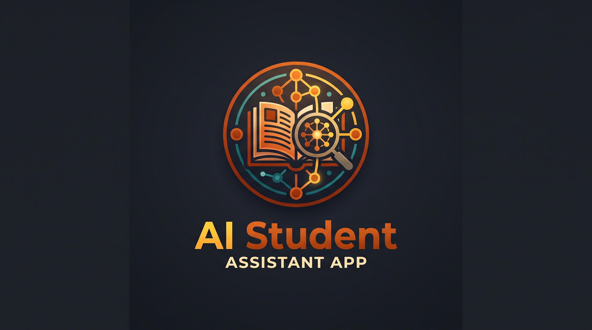
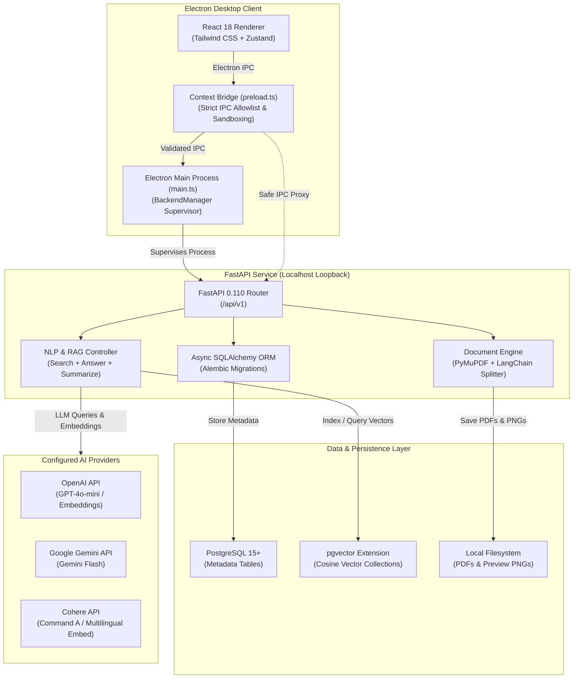

<div align="center">

# AI-Study-Assistant

<p align="center">
  <strong>A local-first, privacy-conscious desktop study assistant that transforms course PDFs into an interactive, cited, and searchable knowledge base.</strong>
</p>

[](LICENSE)
[](https://www.python.org/)
[](https://www.electronjs.org/)
[](https://react.dev/)
[](https://www.typescriptlang.org/)
[](https://fastapi.tiangolo.com/)
[](https://www.postgresql.org/)
[](https://github.com/pgvector/pgvector)
[](frontend/tests)

---



</div>

## Overview

Modern students and researchers are inundated with hundreds of pages of lecture slides, textbook chapters, and scientific papers. Generic AI chatbots often hallucinate, lack access to private course files, or fail to provide verifiable source citations.

**AI-Study-Assistant** solves this problem by combining **retrieval-augmented generation (RAG)** with a **local-first desktop interface**. It indexes your course materials on your machine, extracts text and rendered page previews, performs semantic vector search via PostgreSQL (`pgvector`), and answers study questions strictly grounded in your documents with exact page-level citations.

---

## Table of Contents

- [Key Features](#key-features)
- [System Architecture](#system-architecture)
- [Technology Stack](#technology-stack)
- [Project Structure](#project-structure)
- [Prerequisites](#prerequisites)
- [Installation & Setup](#installation--setup)
  - [Windows Installer (Recommended for Users)](#windows-installer-recommended-for-users)
  - [1. Clone the Repository](#1-clone-the-repository)
  - [2. Start PostgreSQL with pgvector](#2-start-postgresql-with-pgvector)
  - [3. Backend Configuration](#3-backend-configuration)
  - [4. Install Backend Dependencies & Migrate](#4-install-backend-dependencies--migrate)
  - [5. Install Frontend Dependencies](#5-install-frontend-dependencies)
- [How to Run](#how-to-run)
  - [Desktop Application (Development)](#desktop-application-development)
  - [Standalone Web Browser Mode](#standalone-web-browser-mode)
  - [Windows Installer Packaging](#windows-installer-packaging)
- [Usage Workflow](#usage-workflow)
- [API Reference](#api-reference)
- [Configuration Reference](#configuration-reference)
- [Testing & Quality Assurance](#testing--quality-assurance)
- [Security & Privacy](#security--privacy)
- [Troubleshooting](#troubleshooting)
- [Roadmap](#roadmap)
- [Contributing](#contributing)
- [License](#license)
- [Contact](#contact)

---

## Key Features

- **Project-Based Workspaces**: Organize study materials into independent courses or subjects. Each workspace maintains isolated metadata, documents, and vector collections.
- **Multi-PDF Upload & Deduplication**: Upload multiple PDF documents simultaneously with strict MIME validation, file size limits, and SHA-256 content hashing to prevent duplicate indexing.
- **Transparent Processing Pipeline**: Monitor real-time extraction status with distinct states: `uploaded` → `extracting` → `chunking` → `embedding` → `indexing` → `ready` (or `failed`).
- **High-Fidelity Page Previews**: PyMuPDF automatically renders crisp PNG previews for up to 10 pages per document, enabling visual inspection alongside original PDF downloads.
- **Semantic Vector Search**: Perform fast cosine-similarity search across chunk embeddings with configurable score thresholds and instant page-number navigation.
- **Cited RAG Chat Assistant**: Ask complex study questions and receive conversational answers grounded strictly in retrieved document context, complete with verbatim source snippets and page references.
- **Automated Project Summarization**: Generate cohesive multi-document course summaries using single-pass or map-reduce LLM pipelines with in-memory caching.
- **Bilingual & Accessible UI**: Full localization in **English** and **Arabic (RTL)**, dark/light/system themes, density scaling, and reduced-motion support.
- **Desktop-Native Security**: Electron renderer runs with `contextIsolation`, sandboxing, and no direct port exposure; backend is supervised on a dynamic loopback port.

---

## System Architecture

AI-Study-Assistant is split into an **Electron + React** desktop application and an asynchronous **FastAPI + SQLAlchemy** backend service.



### Process Isolation & Security
1. **The Renderer Never Learns the Backend Port**: In Electron, all API calls pass through an allowlisted IPC bridge (`window.aiStudyAssistant`). The main process allocates an ephemeral port on `127.0.0.1` and handles request dispatching, validation, and timeouts.
2. **Supervised Backend**: The Electron main process launches, monitors, health-checks (`GET /api/v1/health`), and terminates the backend process automatically.
3. **Flexible Vector Backend**: Production setups leverage PostgreSQL with `pgvector`, with architectural abstraction allowing future vector database adapters.

---

## Technology Stack

| Domain | Technology | Purpose |
|---|---|---|
| **Desktop Shell** | [Electron 33](https://www.electronjs.org/) | Sandboxed cross-process window management, backend lifecycle supervision |
| **Frontend Framework** | [React 18](https://react.dev/) + [TypeScript 5.7](https://www.typescriptlang.org/) | Reactive component hierarchy, strict type safety |
| **Build Tooling** | [Vite 6](https://vitejs.dev/) | High-speed frontend bundling and HMR development server |
| **Styling & UI** | [Tailwind CSS 3.4](https://tailwindcss.com/) + [Radix UI](https://www.radix-ui.com/) | Accessible, responsive design system with dark/light theme support |
| **State Management** | [Zustand 5](https://github.com/pmndrs/zustand) | Lightweight, decoupled client stores for projects, documents, search, and chat |
| **Testing** | [Vitest 2](https://vitest.dev/) + Testing Library | Fast unit and integration tests (86 tests across 11 test suites) |
| **Backend API** | [FastAPI 0.110](https://fastapi.tiangolo.com/) + [Uvicorn](https://www.uvicorn.org/) | Asynchronous REST API service with automatic OpenAPI documentation |
| **Database & ORM** | [PostgreSQL 15+](https://www.postgresql.org/) + [SQLAlchemy 2.0](https://www.sqlalchemy.org/) | Asynchronous relational schema management with `asyncpg` |
| **Vector Engine** | [pgvector](https://github.com/pgvector/pgvector) | Efficient in-database cosine similarity indexing and nearest-neighbor search |
| **Migrations** | [Alembic 1.14](https://alembic.sqlalchemy.org/) | Schema revision tracking with automatic database stamping |
| **Document Processing**| [PyMuPDF 1.24](https://pymupdf.readthedocs.io/) + [LangChain](https://www.langchain.com/) | High-performance PDF text extraction, chunk splitting, and PNG page previews |
| **LLM & Embeddings** | Cohere / OpenAI / Google Gemini | Multi-provider support for independent embedding and generation models |

---

## Project Structure

```
AI-Study-Assistant/
├── frontend/                     # Electron + React application
│   ├── assets/                   # App icons (SVG, PNG, ICO)
│   ├── electron/                 # Electron main process & IPC security
│   │   ├── main.ts               # Window lifecycle & IPC dispatching
│   │   ├── backend-manager.ts    # Backend spawn, port allocation & health checks
│   │   ├── docker-manager.ts     # Bundled PostgreSQL container lifecycle
│   │   ├── setup-config.ts       # Setup wizard configuration & secret storage
│   │   ├── api-rules.ts          # Route allowlist & upload size validations
│   │   ├── security.ts           # Navigation locks & external link safety
│   │   └── preload.ts            # Typed window.aiStudyAssistant IPC bridge
│   ├── src/                      # React renderer source
│   │   ├── components/           # Reusable UI, layout & document components
│   │   ├── hooks/                # Theme and responsive utility hooks
│   │   ├── lib/                  # API client, error handlers & i18n dictionaries (en/ar)
│   │   ├── pages/                # Dashboard, Projects, Documents, Search, Chat, Setup, Settings
│   │   └── stores/               # Zustand state stores
│   ├── scripts/                  # Build scripts & PyInstaller spec (backend.spec)
│   ├── tests/                    # Vitest unit and integration test suites
│   ├── electron-builder.yml      # NSIS Windows packaging configuration
│   └── package.json              # Frontend scripts & dependencies
├── src/                          # FastAPI backend application
│   ├── assets/                   # Local file storage (files/{project_id}/)
│   ├── controllers/              # Business logic (Process, NLP, Summary, Project)
│   ├── helpers/                  # Configuration loaders (config.py) & migrations (migrations.py)
│   ├── models/                   # SQLAlchemy models, Pydantic schemas & enums
│   │   └── db_schemes/minirag/   # Alembic migration scripts and revisions
│   ├── routes/                   # FastAPI route handlers (data, doc, nlp, project, system)
│   ├── stores/                   # LLM & Vector DB provider implementations
│   ├── main.py                   # FastAPI application entrypoint & lifespan
│   └── requirements.txt          # Python dependencies
├── docker/                       # Docker infrastructure
│   ├── docker-compose.yml        # PostgreSQL + pgvector container definition
│   └── .env.example              # Docker environment variables template
├── API_DOCS.md                   # Full REST API endpoint specification
├── CONTRIBUTING.md               # Open-source contribution guidelines
├── LICENSE                       # Apache-2.0 License
├── TROUBLESHOOTING.md            # Comprehensive diagnostic and error recovery guide
└── WINDOWS_INSTALL.md            # Dedicated Windows installation and build guide
```

---

## Prerequisites

Before setting up the project, ensure you have the following installed:

**Using the Windows installer (end users):**

- **Windows 10/11 x64**
- **Docker Desktop 4+** running with the WSL 2 backend (provides PostgreSQL + pgvector)
- **One AI provider API key** (OpenAI by default)

Python, Node.js, PostgreSQL, and pgvector are **not** required for the installed app.

**Building from source:**

- **Python**: Version `3.12.x` for the backend and packaged executable
- **Node.js**: Version `18.x` or higher and `npm` (Node 22 recommended)
- **PostgreSQL**: Version `15+` with the `pgvector` extension enabled (or [Docker Desktop](https://www.docker.com/))
- **AI Provider API Key**: At least one API key from:
  - [OpenAI](https://platform.openai.com/) (`OPENAI_API_KEY`, default for generation and embeddings)
  - [Cohere](https://cohere.com/) (`COHERE_API_KEY`)
  - [Google Gemini](https://ai.google.dev/) (`GEMINI_API_KEY`)

---

## Installation & Setup

### Windows Installer (Recommended for Users)

The packaged Windows app bundles the React renderer, Electron shell, and a
self-contained PyInstaller backend. No Python or Node.js installation is
required.

1. Download `AI-Study-Assistant Setup 1.0.0.exe` and `SHA256SUMS.txt` from
   [GitHub Releases](https://github.com/YousefOsama20/AI-Study-Assistant/releases)
   and verify the SHA-256 hash.
2. Install and launch the app (the current beta is unsigned; SmartScreen may
   warn).
3. Start **Docker Desktop**.
4. Complete the first-run wizard:
   - **Database** — start the bundled PostgreSQL + pgvector container, or enter
     an existing PostgreSQL server; then test and initialize.
   - **AI providers** — OpenAI is the default for answers and embeddings, so one
     API key is enough. Cohere and Gemini are optional.
   - **Finish** — saves configuration to `%APPDATA%\AI-Study-Assistant`,
     restarts the backend, and opens the dashboard.

See [WINDOWS_INSTALL.md](WINDOWS_INSTALL.md) for the complete end-user guide,
security notes, backup, and troubleshooting.

> [!NOTE]
> The installer is currently a **limited beta**: Docker Desktop remains a
> prerequisite for the bundled database, and release binaries are not yet
> code-signed.

### 1. Clone the Repository

```bash
git clone https://github.com/YousefOsama20/AI-Study-Assistant.git
cd AI-Study-Assistant
```

### 2. Start PostgreSQL with pgvector

You can run PostgreSQL + pgvector using the provided Docker Compose configuration or connect to an existing PostgreSQL instance.

#### Using Docker (Recommended for quick start):
```bash
cd docker
cp .env.example .env
# Edit docker/.env and set your POSTGRES_PASSWORD
docker compose up -d pgvector
```

Initialize the database and enable the vector extension:
```bash
docker exec -it pgvector psql -U postgres -c "CREATE DATABASE ai_study_assistant;"
docker exec -it pgvector psql -U postgres -d ai_study_assistant -c "CREATE EXTENSION IF NOT EXISTS vector;"
cd ..
```
*Note: Docker maps PostgreSQL to host port `5400`.*

### 3. Backend Configuration

Create your backend configuration file from the template:

```bash
cp src/.env.example src/.env
```

Open `src/.env` and update the database connection and your AI provider keys:

```env
# Database Settings (adjust port if using Docker: 5400, or local Postgres: 5432)
POSTGRES_USERNAME="postgres"
POSTGRES_PASSWORD="your_postgres_password"
POSTGRES_HOST="127.0.0.1"
POSTGRES_PORT=5400
POSTGRES_MAIN_DATABASE="ai_study_assistant"

# AI Provider Backends (Providers can be mixed freely)
GENERATION_BACKEND="OPENAI"
EMBEDDING_BACKEND="OPENAI"

# Provider API Keys (leave unused providers empty)
OPENAI_API_KEY="sk-..."
COHERE_API_KEY=""
GEMINI_API_KEY=""

# Model Configuration
GENERATION_MODEL_ID="gpt-4o-mini"
EMBEDDING_MODEL_ID="text-embedding-3-small"
EMBEDDING_MODEL_SIZE=1536

# Vector DB Backend
VECTOR_DB_BACKEND="PGVECTOR"
```

> [!IMPORTANT]
> `EMBEDDING_MODEL_SIZE` must match the exact output dimension of your chosen embedding model (e.g., `384` for `embed-multilingual-light-v3.0`, `1536` for OpenAI `text-embedding-3-small`).

### 4. Install Backend Dependencies & Migrate

```bash
cd src
python -m venv .venv

# On Linux/macOS:
source .venv/bin/activate
# On Windows PowerShell:
# .venv\Scripts\Activate.ps1

pip install --upgrade pip
pip install -r requirements.txt

# Run database migrations with auto-bootstrap:
python -m helpers.migrations upgrade head
cd ..
```

### 5. Install Frontend Dependencies

```bash
cd frontend
npm install
cd ..
```

---

## How to Run

### Desktop Application (Development)

Run the unified Electron desktop application. Electron will compile the main process, launch Vite, allocate a local port, spawn the backend, and display the window:

```bash
cd frontend
npm run electron:dev
```

*To specify a custom Python interpreter for Electron's backend supervisor, set the `AISTUDY_PYTHON` environment variable (e.g., `export AISTUDY_PYTHON="/path/to/src/.venv/bin/python"`).*

### Standalone Web Browser Mode

If you prefer developing the React web interface inside your standard browser:

1. **Terminal 1 (Backend)**:
   Ensure `CORS_ALLOW_ORIGINS="http://localhost:5173"` is set in `src/.env`, then run:
   ```bash
   cd src
   source .venv/bin/activate
   python main.py
   ```
2. **Terminal 2 (Frontend)**:
   ```bash
   cd frontend
   npm run dev
   ```
   Open `http://localhost:5173` in your browser.

### Windows Installer Packaging

To compile a standalone Windows `.exe` installer (bundling the PyInstaller
one-file backend executable and Electron NSIS packaging):

```powershell
powershell -ExecutionPolicy Bypass -File frontend\scripts\build-installer.ps1
```

The script creates an isolated Python 3.12 build environment, smoke-tests the
frozen backend, runs type checks and tests, packages the installer, and writes
checksums. The output is generated at:

```
frontend\dist\AI-Study-Assistant Setup 1.0.0.exe
frontend\dist\SHA256SUMS.txt
```

`npm run dist:win` runs the same pipeline. For advanced Windows packaging and
`%APPDATA%` configuration instructions, see [WINDOWS_INSTALL.md](WINDOWS_INSTALL.md).

---

## Usage Workflow

```
1. Create Project ──> 2. Upload PDFs ──> 3. Process & Extract ──> 4. Search & Chat
```

1. **Create a Study Project**: Navigate to **Projects** and create a project for your subject (e.g., *"Signals & Systems"*).
2. **Upload Course Material**: Drag and drop course PDFs into the **Documents** tab. The system validates MIME types and computes SHA-256 hashes to prevent duplicates.
3. **Process Materials**: Click **Process Documents**. The backend extracts text, splits content into overlapping chunks with 1-based page metadata, computes vector embeddings, and generates PNG page previews.
4. **Inspect Documents**: Click any document to view its rendered page previews or download the original file.
5. **Semantic Search**: Use the **Search** tab to locate concepts using natural language queries. Results display relevance scores and direct page numbers.
6. **Chat with Your Notes**: Open the **Chat** tab to ask questions. The assistant retrieves relevant chunks and constructs a cited answer with source quotations.
7. **Generate Summaries**: Request an automatic summary to generate a comprehensive overview of all materials in the project.

---

## API Reference

The backend provides an interactive OpenAPI interface available at `http://localhost:5000/docs` during runtime. For complete request and response schemas, see [API_DOCS.md](API_DOCS.md).

### Key Endpoints

| Method | Endpoint | Description |
|---|---|---|
| `GET` | `/api/v1/health` | Service readiness check (database, vector store, and AI provider status) |
| `GET` | `/api/v1/system/info` | Runtime system settings (upload limits, chunk sizes, active models) |
| `GET` | `/api/v1/projects` | List projects (supports pagination and search filtering) |
| `POST` | `/api/v1/projects` | Create a new project workspace |
| `POST` | `/api/v1/data/upload/{project_id}` | Upload a PDF document for a project |
| `POST` | `/api/v1/data/process/{project_id}` | Process, chunk, and embed uploaded project documents |
| `GET` | `/api/v1/projects/{project_id}/documents` | Retrieve documents and processing statuses for a project |
| `GET` | `/api/v1/projects/{project_id}/documents/{doc_id}/preview/{page}` | Fetch rendered PNG preview of a document page |
| `POST` | `/api/v1/nlp/index/search/{project_id}` | Perform semantic vector search over project chunks |
| `POST` | `/api/v1/nlp/index/answer/{project_id}` | Query RAG pipeline for cited study answers |
| `POST` | `/api/v1/nlp/summary/{project_id}` | Synthesize a full project summary from document chunks |

### Example cURL Queries

#### Health Check
```bash
curl -X GET http://localhost:5000/api/v1/health
```

#### Semantic Search
```bash
curl -X POST http://localhost:5000/api/v1/nlp/index/search/1 \
  -H "Content-Type: application/json" \
  -d '{"query": "Fourier transform properties", "limit": 5}'
```

#### RAG Question Answering
```bash
curl -X POST http://localhost:5000/api/v1/nlp/index/answer/1 \
  -H "Content-Type: application/json" \
  -d '{"question": "What is the difference between IIR and FIR filters?"}'
```

---

## Configuration Reference

Key variables configurable in `src/.env` (and `%APPDATA%\AI-Study-Assistant\.env` in packaged builds):

| Variable | Default | Description |
|---|---|---|
| `POSTGRES_HOST` | `localhost` | PostgreSQL host address |
| `POSTGRES_PORT` | `5432` | PostgreSQL port (`5400` when using docker-compose) |
| `POSTGRES_USERNAME` | `postgres` | Database user |
| `POSTGRES_PASSWORD` | - | Database password |
| `POSTGRES_MAIN_DATABASE` | `ai_study_assistant` | Application database name |
| `GENERATION_BACKEND` | `OPENAI` | Generation provider (`OPENAI`, `COHERE`, `GEMINI`) |
| `EMBEDDING_BACKEND` | `OPENAI` | Embedding provider (`OPENAI`, `COHERE`, `GEMINI`) |
| `GENERATION_MODEL_ID` | `gpt-4o-mini` | Generation model identifier |
| `EMBEDDING_MODEL_ID` | `text-embedding-3-small` | Embedding model identifier |
| `EMBEDDING_MODEL_SIZE` | `1536` | Embedding vector dimensions (must match model) |
| `VECTOR_DB_BACKEND` | `PGVECTOR` | Vector database engine (`PGVECTOR`, `QDRANT`) |
| `FILE_MAX_SIZE` | `10` | Maximum file upload size in MB |
| `CHUNK_SIZE_DEFAULT` | `1000` | Text chunk character size |
| `CHUNK_OVERLAP_DEFAULT` | `200` | Chunk overlap character size |
| `RAG_ANSWER_LIMIT` | `8` | Top chunk count retrieved for RAG answers |
| `PRIMARY_LANG` | `en` | Primary language for prompts (`en`, `ar`) |
| `CORS_ALLOW_ORIGINS` | `""` | Comma-separated CORS origins (dev browser only) |

---

## Testing & Quality Assurance

### Frontend Test Suite
The frontend utilizes [Vitest](https://vitest.dev/) and `@testing-library/react`. 12 test suites verify state stores, navigation, upload validation, security policies, setup configuration, and IPC error handling:

```bash
cd frontend
npm test
```
```
Test Files  12 passed (12)
     Tests  94 passed (94)
```

### Static Typechecking
Verify TypeScript types across both the React renderer and the Electron main process:
```bash
cd frontend
npm run typecheck
```

### Backend Syntax Verification
Verify Python syntax and module imports:
```bash
python -m compileall -q src
```

---

## Security & Privacy

- **Local Document Storage**: Uploaded PDFs and extracted chunk data remain on your local storage (`src/assets/` or `%APPDATA%\AI-Study-Assistant\data`). Files are never transmitted to unauthorized third parties.
- **Strict Process Sandboxing**: The Electron renderer runs with `contextIsolation: true`, `nodeIntegration: false`, and `sandbox: true`. Arbitrary navigation, file-URL escapes, permissions, and new window popups are denied.
- **Per-Launch API Token**: The Electron main process generates a random bearer token for every launch and passes it only to the bundled backend. The renderer never receives the token or the backend port; all API calls go through an allowlisted IPC bridge.
- **Secret Isolation**: In the installed app, API keys and the database password are stored in `%APPDATA%\AI-Study-Assistant\.env` and passed to the backend as environment variables. They never enter the renderer, installer, logs, or repository. Backend logs redact known secret values and rotate at 5 MB.
- **Local-Only Backend**: The packaged backend binds strictly to `127.0.0.1` on a dynamically assigned port and requires the per-launch token for every request.

---

## Troubleshooting

For in-depth diagnostics, consult [TROUBLESHOOTING.md](TROUBLESHOOTING.md).

- **Backend Degraded / 503**:
  Check `GET /api/v1/health`. Ensure PostgreSQL is running and the `vector` extension is installed (`CREATE EXTENSION IF NOT EXISTS vector;`).
- **Embedding Dimension Mismatch**:
  If you switch embedding models, update `EMBEDDING_MODEL_SIZE` in `.env` and re-index existing projects.
- **Missing Migrations**:
  Run `python -m helpers.migrations upgrade head` from the `src/` directory.

---

## Roadmap

- [ ] **Streaming Chat**: Server-Sent Events (SSE) for word-by-word LLM token streaming.
- [ ] **Persisted Chat History**: SQLite/PostgreSQL storage for multi-turn conversations across sessions.
- [ ] **Local Offline Models**: Native support for local embedding and generation via Ollama or llama.cpp.
- [ ] **Cross-Platform Installers**: Linux AppImage/deb and macOS DMG packaging.
- [ ] **Additional File Types**: Support for `.docx`, `.pptx`, and `.epub` course materials.

---

## Contributing

Contributions make the open-source community thrive! Please see [CONTRIBUTING.md](CONTRIBUTING.md) for full instructions on setting up your environment, coding standards, and opening a Pull Request.

1. Fork the Project
2. Create your Feature Branch (`git checkout -b feature/AmazingFeature`)
3. Commit your Changes (`git commit -m 'Add some AmazingFeature'`)
4. Push to the Branch (`git push origin feature/AmazingFeature`)
5. Open a Pull Request

---

## License

Distributed under the **Apache License 2.0**. See [`LICENSE`](LICENSE) for details.

---

## Contact

- **Author**: Yousef Osama
- **GitHub Repository**: [https://github.com/YousefOsama20/AI-Study-Assistant](https://github.com/YousefOsama20/AI-Study-Assistant)
- **Issue Tracker**: [https://github.com/YousefOsama20/AI-Study-Assistant/issues](https://github.com/YousefOsama20/AI-Study-Assistant/issues)
